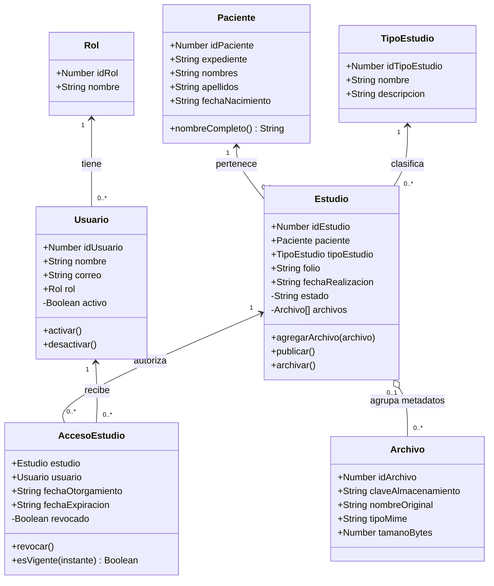

# Diagrama de clases de ID3D

Versión actualizada para Desarrollo de Software, Unidad I.

## Reglas y alcance

- Cada Usuario tiene un Rol; cada Estudio tiene un Paciente y un TipoEstudio.
- Estudio expone getters `estado` y `archivos`; Usuario expone `activo` y AccesoEstudio
  expone `revocado`. La colección de archivos se devuelve como una copia.
- Los catálogos Rol, TipoEstudio y los metadatos Archivo son objetos de datos; no se
  inventan operaciones para clases que no las necesitan en esta iteración.
- Se permite publicar únicamente desde EN_PREPARACION y con al menos un archivo.
- Se permite archivar únicamente desde PUBLICADO.
- Un permiso habilita la consulta solo si el usuario está activo, el estudio está
  publicado, no está revocado y la fecha está dentro del intervalo [inicio, fin).
- La expiración y la fecha de nacimiento pueden ser null.
- Un objeto Archivo recién creado puede no estar asignado todavía; al agregarlo queda
  asociado a un solo Estudio y no puede reutilizarse en otro. El registro persistido en
  MySQL requerirá siempre id_estudio. La unicidad global de claves entre objetos
  distintos se impondrá en persistencia.
- AccesoEstudio es la clase de asociación entre Usuario y Estudio. La unicidad del par
  se impondrá con la PK compuesta de MySQL al incorporar persistencia.

## Relación con el diseño de MySQL

Las siete clases corresponden a las siete entidades trabajadas. En memoria, las FK
se representan mediante referencias a objetos. Los identificadores se proporcionan
al constructor; la futura persistencia utilizará AUTO_INCREMENT. No se implementa
hash_contrasena en Usuario porque la autenticación no forma parte de esta demo;
se añadirá en un componente seguro al integrar el inicio de sesión. La aplicación
no debe almacenar contraseñas en texto plano. Los tamaños se limitan a enteros seguros
de JavaScript; no se utiliza todo el rango BIGINT UNSIGNED de MySQL.

La orientación a objetos se demuestra con clases, instancias, encapsulación,
asociaciones y métodos. No se incorpora herencia artificial: no hay una relación
«es un» que la justifique en estas siete clases.
